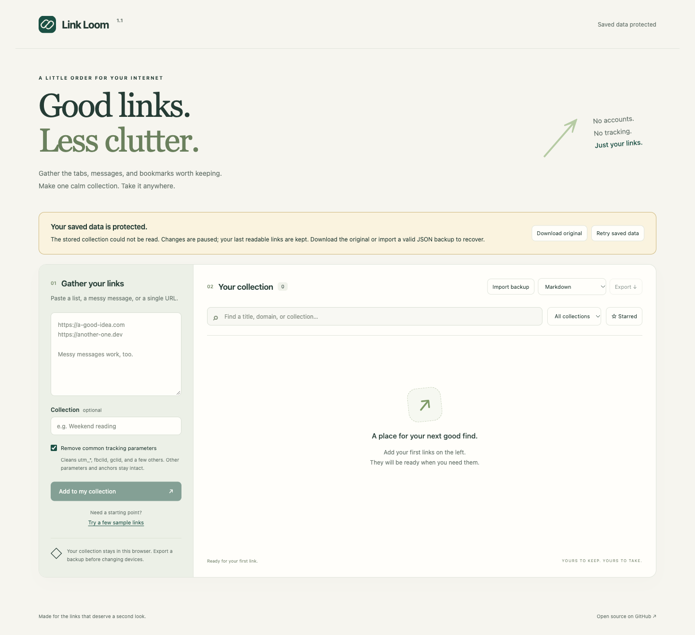

# Link Loom

**A little order for your internet.** Turn links scattered across chats, tabs, and notes into one searchable collection.

[Try the live app](https://metealpkarvan.github.io/link-loom/) · [Türkçe](README.tr.md) · [Releases](https://github.com/metealpkarvan/link-loom/releases) · [Report a bug](https://github.com/metealpkarvan/link-loom/issues)

[](https://github.com/metealpkarvan/link-loom/actions/workflows/ci.yml)


## Why it exists

Saving a link should be easier than choosing a bookmark manager. Link Loom takes pasted URLs, removes common tracking parameters, skips duplicates, and gives useful links a small home. It works without an account or a backend.

## Use it in a minute

1. Paste URLs or a message containing links. Bare domains such as `example.com` also work.
2. Optionally name a collection, then select **Add to my collection**.
3. Rename links, star favorites, and search by title, URL, or collection.
4. Export **Markdown** for your notes, **Browser bookmarks** for a browser import, or **JSON backup** to restore on another device.

The sample button fills the input with four URLs. Adding them produces three links: two sample URLs point to the same cleaned address.

## What you get

- Common tracking cleanup: `utm_*`, `fbclid`, `gclid`, `dclid`, `msclkid`, `mc_cid`, `mc_eid`, `_hsenc`, and `_hsmi`.
- Deduplication after normalization; distinct legitimate queries and fragments remain separate.
- Named collections, editable titles, starred links, and combined search filters.
- Persistent browser storage and updates across open tabs, with a check for changed saved data before writing.
- Three export formats and validated, additive JSON imports. Existing link metadata wins on duplicates.
- A visible recovery notice when saved data cannot be read, with an original-text download and an explicit backup restore.
- A responsive layout, labeled controls, keyboard focus, and live action feedback.

## Privacy and boundaries

The app does not fetch your links, send your collection to a server, or load external fonts, images, analytics, or libraries. Only the app's own static files are requested. Following a link opens that website normally.

Your data lives in `localStorage` for the current browser and origin. Clearing browser data deletes it. Different browsers and devices do not sync. **Export a JSON backup to keep a portable copy.** Browser storage is not encrypted; anyone with access to your browser profile may read it.

Tracking cleanup can invalidate signed links. Turn it off for those links. A query with no known tracker is left unchanged; removing a tracker may re-encode the remaining query through the browser's URL parser. The app neither checks whether links are alive nor automatically retrieves page titles.

Collections are limited to 1,000 links and a portable JSON backup of **2,000,000 UTF-8 bytes**. The same byte limit applies when adding, editing, importing, saving, and exporting, so an accepted collection can be exported and imported again. HTTP and HTTPS only; embedded URL credentials are rejected. Imports validate the entire backup before changing saved data. Version 1 backups remain supported when they fit these limits.

If saving fails, the current collection stays intact and the change is rejected. When browser storage cannot be accessed, the app shows **Session only — export to keep**. Export your session collection before closing the page.

## Recover saved data

If saved data cannot be read, a persistent **Saved data protected** notice appears. Adding, saving edits, starring, and deleting are blocked. The last readable collection and any open edit draft stay available; a failed first load shows an empty collection. The original saved text is kept.



1. Select **Download original** to save the untouched stored text as a recovery `.txt` file. Keep it even if it is not valid JSON.
2. Select **Retry saved data** after fixing or replacing the saved data elsewhere. If it becomes readable, the app loads it again.
3. To restore a valid **JSON backup** while protected, choose the file and confirm the replacement. The backup is merged with the last readable collection, keeping existing metadata on duplicate links. The app starts a download of the original text before saving this merged collection in place of the protected data. Check that the recovery file was downloaded.

In normal use, JSON imports add links and keep existing metadata on duplicates. Recovery imports apply the same merge to the last readable collection, then replace protected data after confirmation. If another tab changes saved data before an action is saved, the app rereads the current storage value and rejects the attempted change. Review the refreshed collection before trying again. This is a check before writing; browser storage does not provide a transaction across tabs.

Recovery files and JSON backups may contain private links. Keep them somewhere appropriate; the app does not upload them.

## Run locally

Requires Python 3 for the static server. Node.js 22+ is needed only for tests.

To run a release ZIP, extract it and serve the extracted directory with the Python command below. The ZIP contains the complete static app and needs no dependency installation or build step.

```bash
git clone https://github.com/metealpkarvan/link-loom.git
cd link-loom
python3 -m http.server 8080 --bind 127.0.0.1
# Open http://localhost:8080
```

The JavaScript uses native ES modules, so serve the folder over HTTP rather than opening `index.html` directly. On Windows, use `py -m http.server 8080 --bind 127.0.0.1` if Python is installed through the launcher.

```bash
npm test
python3 scripts/package.py
```

There is no dependency installation or build step. The Node test runner checks normalization, unsafe URL rejection, deduplication, import atomicity, UTF-8 backup limits, metadata preservation, recovery states, stale-write rejection, and safe export escaping.

The Python packaging script uses only the standard library. It writes `dist/link-loom-v1.1.0.zip` and `dist/SHA256SUMS.txt`, includes the static app and public guides, and checks that archived files match the source bytes. Extract the ZIP and serve its directory over local HTTP; its ES module paths stay the same. From `dist`, verify the archive with `shasum -a 256 -c SHA256SUMS.txt`.

CI runs tests and packaging on Node 22/24 Linux jobs and native Mac jobs. See [verification](docs/VERIFICATION.md) for tested flows and remaining limits.

## Small by design

`src/links.js` contains the independently tested data logic. `src/storage.js` checks saved data and guards writes. `src/app.js` handles the DOM and renders user data with `textContent`. `index.html` and `styles.css` define the interface. GitHub Actions tests the app before publishing the static demo.

Possible next steps: Netscape bookmark import and an undo action. See the [roadmap](docs/ROADMAP.md), [changelog](CHANGELOG.md), and [contributing guide](CONTRIBUTING.md).

**Türkçe:** Mesajlara ve notlara dağılmış bağlantıları temizleyen, düzenleyen ve dışa aktaran küçük bir araç. Veriler tarayıcıda saklanır; hesap açmak gerekmez.

MIT © Mete Alp Karvan


## Mac architecture support

The browser app supports both Intel and Apple Silicon Macs through a modern browser. No Rosetta or processor-specific app package is needed. CI is configured to run the rule and storage tests with native Node.js on x86_64 and arm64 macOS runners; browser/device coverage is separate from these checks. Release ZIPs contain architecture-independent HTML, CSS and JavaScript.
