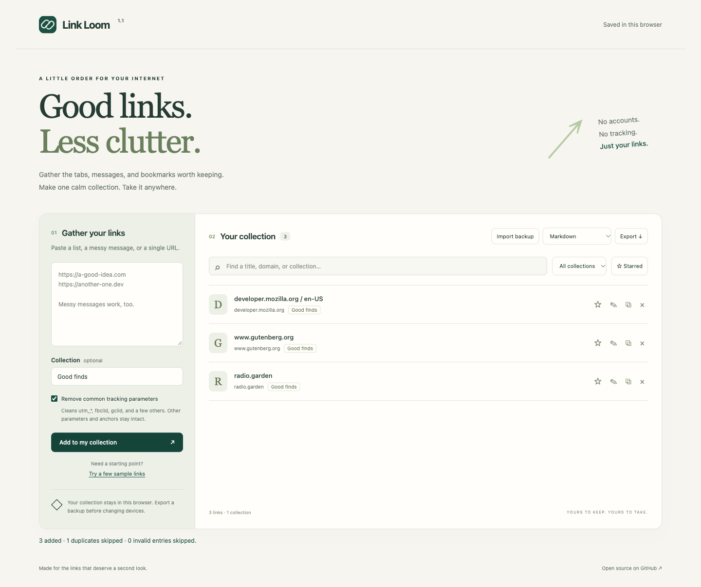

# Link Loom

**A little order for your internet.** Turn links scattered across chats, tabs, and notes into one searchable collection.

[Try the live app](https://metealpkarvan.github.io/link-loom/) · [Report a bug](https://github.com/metealpkarvan/link-loom/issues)

[](https://github.com/metealpkarvan/link-loom/actions/workflows/ci.yml)



## Why it exists

Saving a link should be easier than choosing a bookmark manager. Link Loom takes pasted URLs, removes common tracking parameters, skips duplicates, and gives useful links a small home. It works without an account or a backend.

## Use it in a minute

1. Paste URLs or a message containing links. Bare domains such as `example.com` also work.
2. Optionally name a collection, then select **Add to my collection**.
3. Rename links, star favorites, and search by title, URL, or collection.
4. Export **Markdown** for your notes, **Browser bookmarks** for a browser import, or **JSON backup** to restore on another device.

The sample button fills the input with four URLs. Adding them produces three links: two sample URLs point to the same cleaned address.

## What you get

- Common tracking cleanup: `utm_*`, `fbclid`, `gclid`, `dclid`, `msclkid`, `mc_cid`, `mc_eid`, `_hsenc`, and `_hsmi`.
- Deduplication after normalization; distinct legitimate queries and fragments remain separate.
- Named collections, editable titles, starred links, and combined search filters.
- Persistent browser storage and updates across open tabs.
- Three export formats and validated, additive JSON imports. Existing link metadata wins on duplicates.
- A responsive layout, labeled controls, keyboard focus, and live action feedback.

## Privacy and boundaries

The app does not fetch your links, send your collection to a server, or load external fonts, images, analytics, or libraries. Only the app's own static files are requested. Following a link opens that website normally.

Your data lives in `localStorage` for the current browser and origin. Clearing browser data deletes it. Different browsers and devices do not sync. **Export a JSON backup to keep a portable copy.** Browser storage is not encrypted; anyone with access to your browser profile may read it.

Tracking cleanup can invalidate signed links. Turn it off for those links. A query with no known tracker is left unchanged; removing a tracker may re-encode the remaining query through the browser's URL parser. The app neither checks whether links are alive nor automatically retrieves page titles.

Collections are limited to 1,000 links; JSON imports to 2 MB. HTTP and HTTPS only; embedded URL credentials are rejected. Imports validate the entire backup before changing saved data. If saving fails, the current collection stays intact and the change is rejected. If stored data is unreadable, a session-only collection opens without overwriting it.

## Run locally

Requires Python 3 for the static server. Node.js 22+ is needed only for tests.

```bash
git clone https://github.com/metealpkarvan/link-loom.git
cd link-loom
python3 -m http.server 8080 --bind 127.0.0.1
# Open http://localhost:8080
```

The JavaScript uses native ES modules, so serve the folder over HTTP rather than opening `index.html` directly. On Windows, use `py -m http.server 8080 --bind 127.0.0.1` if Python is installed through the launcher.

```bash
npm test
```

There is no dependency installation or build step. The Node test runner checks normalization, unsafe URL rejection, deduplication, import atomicity, capacity limits, metadata preservation, and safe export escaping. CI runs on Node 22 and 24.

## Small by design

`src/links.js` contains the independently tested data logic. `src/app.js` handles the DOM and persistence; it renders user data with `textContent`. `index.html` and `styles.css` define the interface. GitHub Actions tests the app before publishing the static demo.

Possible next steps: Netscape bookmark import and an undo action. See [CONTRIBUTING.md](CONTRIBUTING.md) for development notes.

**Türkçe:** Mesajlara ve notlara dağılmış bağlantıları temizleyen, düzenleyen ve dışa aktaran küçük bir araç. Veriler tarayıcıda saklanır; hesap açmak gerekmez.

MIT © Mete Alp Karvan


## Mac architecture support

The browser app supports both Intel and Apple Silicon Macs through a modern browser. No Rosetta or processor-specific app package is needed. CI runs the rule tests with native Node.js on x86_64 and arm64 macOS runners; browser/device coverage is separate from these checks. The downloaded ZIP contains the same architecture-independent HTML, CSS and JavaScript as the live app.
